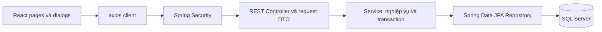

# Thiết kế dự kiến

Trạng thái 28/10/2026 sau M1: nền tảng Boot 3/SQL Server đã chạy bằng CLI; chưa có các lớp nghiệp vụ/API/React được mô tả bên dưới. Yêu cầu và các quyết định DEC tham chiếu [requirements.md](requirements.md).

## Nền tảng M1 đã triển khai

- POM dùng Spring Boot **3.5.16**, Java 21; Web, Data JPA, Validation, Test; JDBC `12.10.2.jre11` và Hibernate `6.6.53.Final` do BOM quản lý, không override version rời. [System requirements](https://docs.spring.io/spring-boot/3.5/system-requirements.html) xác nhận JDK 21 nằm trong dải tương thích. [Release notes](https://spring.io/blog/2026/06/25/spring-boot-3-5-16-available-now/) ghi bản OSS cuối nhánh 3.5; chọn major 3 theo đề.
- `application.properties` ghép URL từ `SQLSERVER_HOST` (bắt buộc), `SQLSERVER_PORT` (mặc định 1433), tên DB cố định `A2PhanTuanThanh_SE1910`; credentials tách qua `SQLSERVER_USERNAME/PASSWORD`. `SQLSERVER_INTEGRATED_SECURITY` mặc định false; lần chạy thật dùng true theo sinh viên, danh tính Windows hiện tại và native DLL x64 cùng version JDBC.
- TLS mặc định `SQLSERVER_ENCRYPT=true`, `SQLSERVER_TRUST_SERVER_CERTIFICATE=false`; lần chạy local bật trust certificate tường minh. `applicationName` cho phép đối chiếu session SQL với PID Java. Không có credential hard-code hoặc trong URL mẫu.
- `scripts/create-database.sql` chỉ tạo DB nếu chưa tồn tại. Khảo sát thật thấy DB chưa có; tool tạo DB, sau đó JDBC và SQL metadata xác nhận đúng tên, SQL Server 16.0.1000.6, TCP/NTLM/encryption TRUE. DB có 0 user tables trước và sau chạy. Đây chưa nghiệm thu phần JPA sinh schema của REQ-03/DEC-03.
- `ddl-auto=none` cho M1; `open-in-view=false` để không kéo truy vấn persistence sang web view. Khi triển khai M2 mới chốt entity/schema và đổi chính sách DDL với test riêng.
- Tests cần DB thật và môi trường hợp lệ; không có H2, mock datasource hoặc profile né kiểm tra kết nối. README có cách cài native DLL, cấu hình PowerShell/IntelliJ và mẫu `.env.example` không tự nạp.
- [Evidence M1](evidence/2026-10-28-m1/inspection.md): 2 tests pass và JAR HTTP smoke pass. IntelliJ do sinh viên chạy vẫn chưa kiểm chứng; SQL login và TLS với chứng chỉ tin cậy chưa chạy.

## 1. Kiến trúc SBA301



Ba lớp của backend là presentation (Controller), business (Service), persistence (Repository). Entity là mô hình persistence; DTO, mapper, security và exception là các thành phần hỗ trợ. Controller xử lý HTTP/validation DTO, service quyết định quyền/nghiệp vụ/transaction, repository truy vấn dữ liệu. Dùng constructor injection; không trả entity trực tiếp ra API và không gọi repository từ controller.

Giữ main application trong `fpt.edu.a2phantuanthanh_se1910`, các package ứng dụng nằm bên dưới để Spring quét component/entity. Spring Boot không bắt buộc một cây thư mục duy nhất; cách chia theo lớp dưới đây được chọn để thể hiện rõ yêu cầu ba lớp của SBA301. [Spring Boot 3.5: Structuring Your Code](https://docs.spring.io/spring-boot/3.5/reference/using/structuring-your-code.html).

```text
A2PhanTuanThanh_SE1910/                 # repo và backend hiện có
├── pom.xml                            # hiện đã Boot 3.5.16 ở M1
├── mvnw, mvnw.cmd, .mvn/
├── src/main/java/fpt/edu/a2phantuanthanh_se1910/
│   ├── A2PhanTuanThanhSe1910Application.java
│   ├── controller/                    # Auth, PublicNews, Account, Category, News, Profile
│   ├── service/                       # interface nghiệp vụ
│   │   └── impl/                      # triển khai service, @Transactional
│   ├── repository/                    # JpaRepository và truy vấn
│   ├── entity/                        # SystemAccount, Category, NewsArticle, Tag, NewsTag
│   ├── dto/request/                   # DTO create/update/login riêng
│   ├── dto/response/                  # DTO không chứa password/hash
│   ├── mapper/                        # mapping tường minh, không cần thêm thư viện
│   ├── security/                      # principal, JWT, quyền truy cập
│   ├── config/                        # Security, CORS, cấu hình ứng dụng
│   ├── exception/                     # exception và @RestControllerAdvice
│   └── bootstrap/                     # dữ liệu demo bằng repository, profile riêng
├── src/main/resources/
│   ├── application.properties
│   └── application-demo.properties    # tham chiếu biến môi trường
├── src/test/java/fpt/edu/a2phantuanthanh_se1910/
│   ├── service/
│   ├── controller/
│   └── integration/
├── frontend/A2PhanTuanThanh_SE1910/     # project React có tên folder đúng đề
│   └── src/
│       ├── api/                       # axios instance, hàm gọi API
│       ├── auth/                      # trạng thái đăng nhập và route guard
│       ├── pages/                     # PublicNews, Accounts, Categories, News, Profile, History
│       ├── components/                # dialogs, form fields, confirmation
│       └── routes/
└── docs/
```

Frontend là project riêng trong cùng repo, không nằm trong Java package hay template Thymeleaf. Folder giữ `A2PhanTuanThanh_SE1910`; `package.json.name` dự kiến `a2phantuanthanh-se1910`. Tên DB là `A2PhanTuanThanh_SE1910`.

Đã có ở M1: Spring Web, Data JPA, Validation, Microsoft SQL Server JDBC driver và Spring Boot Test. Security, Spring Security Test và JWT còn dự kiến ở M3; thư viện JWT được chọn/khóa version khi triển khai. POM hiện là 3.5.16, JDK 21. Không trộn namespace `javax.persistence` với `jakarta.persistence`; `javax.sql.DataSource` trong test là API Java SE hợp lệ.

## 2. Entity và trường dữ liệu

PDF chỉ cung cấp tên trường. Kiểu và giới hạn dưới đây là **đề xuất DEC-02**, chưa phải schema đang tồn tại. Tên bảng/cột map tường minh để giữ tương ứng với sơ đồ. Dùng Unicode cho văn bản tiếng Việt trên SQL Server.

| Entity | Trường theo sơ đồ và kiểu dự kiến |
|---|---|
| SystemAccount | AccountID: Long identity; AccountName: String(100); AccountEmail: String(254), unique; AccountRole: Integer 1/2; AccountPassword: String(255) chứa BCrypt hash |
| Category | CategoryID: Long identity; CategoryName: String(100); CategoryDescription: String(1000), tùy chọn; ParentCategoryID: FK Category nullable; IsActive: Integer 0/1 |
| NewsArticle | NewsArticleID: Long identity; NewsTitle: String(200); Headline: String(300); CreatedDate: LocalDateTime; NewsContent: Unicode large text; NewsSource: String(500), tùy chọn; CategoryID: FK bắt buộc; NewsStatus: Integer 0/1; CreatedByID: FK bắt buộc; UpdatedByID: FK nullable; ModifiedDate: LocalDateTime nullable |
| Tag | TagID: Long identity; TagName: String(100); Note: String(500), tùy chọn |
| NewsTag | NewsArticleID và TagID: khóa ghép, đồng thời FK; unique TagID dự kiến theo DEC-01 |

Mapping dự kiến:

- `NewsArticle.category`: `@ManyToOne`, một bài thuộc đúng một category.
- `NewsArticle.createdBy`: `@ManyToOne` tới SystemAccount. CreatedByID lấy từ principal Staff tại lúc tạo; FE không được đặt field này.
- `NewsArticle.updatedBy`: `@ManyToOne`, lấy từ principal khi sửa; không cho payload giả mạo.
- `Category.parentCategory`: self-reference `@ManyToOne`, nullable. Chặn self-parent và vòng lặp nhiều cấp.
- `NewsTag`: entity nối với embedded key; mapping tới NewsArticle và Tag. Tạm giữ unique TagID, chờ chốt DEC-01. Không tự chuyển thành many-to-many tái sử dụng tag trái với phần chữ.
- Dùng lazy loading cho quan hệ; chuyển entity sang response DTO trong service/transaction để tránh vòng lặp JSON và lộ password.
- Không cascade REMOVE từ account/category tới bài. Khi xóa bài chỉ xóa liên kết NewsTag; Tag không còn dùng có thể tồn tại với 0 bài theo đề.

SQL Server instance và database rỗng phải sẵn sàng để kết nối. Ở profile phát triển, JPA/Hibernate sinh cấu trúc bảng từ entity; cấu hình `ddl-auto` tường minh. Dự kiến `update` cho DB demo và `validate` khi xác minh schema đã ổn định. Không dùng `create-drop` với dữ liệu cần giữ. Chụp minh chứng trên database rỗng để chứng minh schema do JPA tạo. [Spring Boot 3.5: Database Initialization](https://docs.spring.io/spring-boot/3.5/how-to/data-initialization.html).

## 3. Quy tắc nghiệp vụ ở service

| Service | Quy tắc quan trọng |
|---|---|
| AccountService | Admin CRUD/search; email trim/chuẩn hóa nhất quán và unique; không trả password/hash; `existsByCreatedBy...` chặn delete cho mọi news status |
| CategoryService | Staff CRUD/search; kiểm tra parent tồn tại/không chu kỳ; `existsByCategory...` chặn delete cho mọi news status |
| NewsArticleService | Staff CRUD/search; kiểm tra category/tag hợp lệ; server gán creator/updater/date; lưu bài và links trong một transaction |
| ProfileService | Dựa vào principal thay vì ID tùy ý; DTO chỉ cho sửa tên/email/password; role và ID không được thay đổi |
| AuthService | Đăng nhập bằng email/password; BCrypt verify; trả token và thông tin role; thông báo lỗi đăng nhập không tiết lộ password |
| PublicNewsService | List/detail chỉ NewsStatus=1; bài inactive hoặc không tồn tại trả 404 ở detail |

Account chưa tạo bài nhưng xuất hiện trong UpdatedByID được xử lý theo DEC-06; category có con nhưng chưa được bài dùng theo DEC-05. Database FK/unique là lớp bảo vệ cuối cùng cho truy cập đồng thời; chuyển lỗi xung đột constraint thành 409 thay vì để 500. Service check đơn lẻ không thay thế constraint.

History là query `CreatedByID = principal.accountId`, không lấy ID người khác từ request. Staff quản lý news chung theo ma trận quyền; chức năng history chỉ hiển thị news của mình.

## 4. API dự kiến và quyền

Tất cả route sau là hợp đồng đề xuất, **chưa tồn tại trong code**. ID trên path là số nguyên dương. `q` là query search đã trim; giới hạn độ dài 200 ký tự là lựa chọn triển khai.

| Method/route | Quyền | Mục đích |
|---|---|---|
| POST `/api/auth/login` | Public | Đăng nhập email/password |
| GET `/api/public/news?q=` | Public | List/search tin active |
| GET `/api/public/news/{id}` | Public | Chi tiết tin active |
| GET `/api/accounts?q=`; GET `/api/accounts/{id}` | Admin | Read/search account |
| POST `/api/accounts`; PUT `/api/accounts/{id}`; DELETE `/api/accounts/{id}` | Admin | Create/update/delete account |
| GET `/api/categories?q=`; GET `/api/categories/{id}` | Staff | Read/search category |
| POST `/api/categories`; PUT `/api/categories/{id}`; DELETE `/api/categories/{id}` | Staff | Create/update/delete category |
| GET `/api/news?q=`; GET `/api/news/{id}` | Staff | Read/search cả hai trạng thái |
| POST `/api/news`; PUT `/api/news/{id}`; DELETE `/api/news/{id}` | Staff | Quản lý bài và tags trong cùng payload |
| GET `/api/tags?q=` | Staff | Tag lookup cho form, trả tag chưa gắn hoặc thuộc bài đang sửa |
| GET `/api/profile`; PUT `/api/profile` | Staff | Hồ sơ hiện tại |
| GET `/api/profile/news?q=` | Staff | Lịch sử bài của mình |

Quản lý tags nằm trong dialog bài viết: thêm tag mới, sửa tên/note của tag thuộc bài, gắn tag chưa thuộc bài và bỏ gắn tag. Theo DEC-01, tag thuộc bài khác phải bị từ chối ở BE kể cả bị gửi thủ công. Payload cần phân biệt tag có `id` với tag mới, loại duplicate ID, kiểm tra quyền sửa tag trong cùng transaction. Không bắt buộc một màn CRUD tag độc lập.

HTTP: GET/update 200, create 201 với Location, delete 204; validation 400; thiếu/sai/hết hạn xác thực 401; sai role 403; không tìm thấy 404; delete bị chặn hoặc trùng email/tag conflict 409. `RestControllerAdvice` trả lỗi thống nhất gồm `status`, `code`, `message`, `fieldErrors`, `path`, `timestamp`. Không trả stacktrace, token, password hoặc hash.

JWT: khóa ký qua biến môi trường, expiration hữu hạn; request axios gửi bearer token. BE tra trạng thái/role hiện tại của account khi xác thực để việc đổi role hoặc xóa account không để token cũ tiếp tục có quyền. FE xóa phiên khi logout hoặc nhận 401. CORS chỉ cho origin FE đã cấu hình. Chi tiết thư viện/thời hạn sẽ được ghi khi triển khai và có test; chưa có token implementation hiện tại.

## 5. Validation dự kiến cho toàn bộ dữ liệu đầu vào

| Nhóm field | Quy tắc dự kiến |
|---|---|
| ID/path/FK | Số nguyên dương; route không nhận chữ; FK tồn tại; ID entity mới do DB sinh |
| AccountName, CategoryName, TagName | Trim, không blank, tối đa theo schema |
| AccountEmail | Không blank, format email, tối đa 254; unique sau chuẩn hóa |
| Password tạo/login/đổi | Không blank khi bắt buộc; tạo/đổi áp dụng chính sách thống nhất; tối đa 72 byte UTF-8 cho BCrypt; không trim password; sửa account không gửi password thì giữ hash cũ |
| AccountRole | Chỉ 1 hoặc 2; chỉ Admin được đặt qua account API |
| IsActive, NewsStatus | Integer 0 hoặc 1, không null; từ chối giá trị ngoài miền và kiểu sai |
| NewsTitle, Headline, NewsContent | Không blank; title≤200, headline≤300; content dự kiến≤20.000 ký tự; đồng bộ max với UI |
| Description, Source, Note | Có thể trống; giới hạn 1000/500/500; NewsSource không bắt buộc URL vì đề không nói vậy |
| ParentCategoryID | Null hoặc ID tồn tại; không tự tham chiếu/chu kỳ |
| CreatedByID, UpdatedByID, CreatedDate, ModifiedDate | Server quản lý, không nhận trong DTO ghi; trả thời gian theo quy ước UTC rõ ràng |
| Tags collection | ID không lặp; tag mới validate tên/note; ownership/cardinality theo DEC-01; đề chưa quy định số tag tối thiểu nên tạm cho phép 0 |
| Query search | String trim, giới hạn 200; giá trị rỗng tương đương không lọc; dùng parameter binding |

Độ dài password tối thiểu dự kiến 8 ký tự cho tạo/đổi, không áp đặt lên login của tài khoản có sẵn. Validate BE bằng Jakarta Validation, custom rule và service; FE dùng cùng quy tắc để phản hồi sớm. Test cả JSON sai kiểu và numeric coercion để không vô tình nhận `1.5` thành `1`.

## 6. React và tương tác

- Các page quản lý có list, search và nút mở create/update dialog. Có loading, empty, error; form không đóng khi BE trả lỗi.
- Shared `ConfirmDialog` cho mọi thao tác delete. Cancel chỉ đóng dialog; Confirm mới gọi axios DELETE; 409 hiển thị lý do từ BE.
- Form news chọn category/status và sửa tags; creator/date không phải input sửa được.
- Sau mutation thành công, tải lại danh sách/chi tiết liên quan để chứng minh trạng thái đồng bộ với DB. Chặn double submit trong lúc request đang chạy.
- Public page dùng public API; protected route giúp UX, quyền thực tế vẫn do BE kiểm tra.

## 7. Chưa chốt/chưa kiểm chứng

DEC-01 và DEC-03 cần làm rõ; Boot đã khóa 3.5.16, JWT library chưa chọn. SQL Server connectivity đã kiểm chứng ở M1; mapping JPA nghiệp vụ, sinh schema, token, DTO, route và React chưa triển khai. Chưa xác nhận thao tác IntelliJ của sinh viên. Mọi thay đổi thiết kế sau đó phải cập nhật requirements, test matrix và code-flow trong cùng nhịp triển khai.
